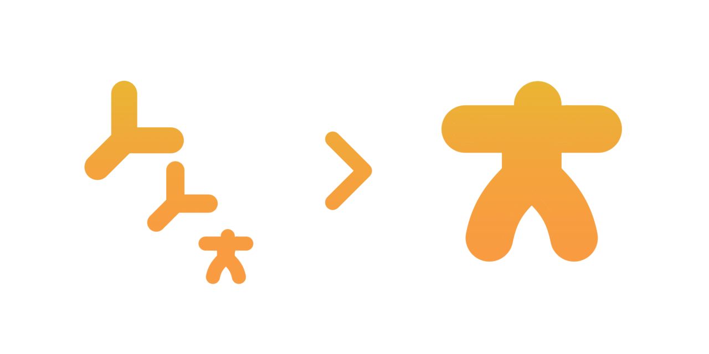

<h1 align="center">FBX Rerooter</h1>
<p align="center">A simple tool for re-rooting your FBX skeletons.</p>

## Why This Exists

When exporting models or animations from the Unity Editor, the FBX Exporter often excludes root motion bones of a skeleton from the bone hierarchy itself since the root motion bone usually doesn't carry any weights to any skinned meshes. The test file, `test/Skeleton.fbx`, demonstrates this hierarchy:

```
Skeleton (Null)
└─ Root (Null)
   └─ Hips (LimbNode)
      └─ Spine (LimbNode)
         └─ Chest (LimbNode)
            └─ Neck (LimbNode)
```

The skeleton starts at `Hips`, not `Root`. `Root` is excluded from the skeleton, which should not be the case. If you want to retain the root motion (especially for retargeting purposes), you'll have to reconstruct the root motion bone within the skeleton and transfer the motion from the parent node.

To solve this, this tool inspects the FBX skeleton hierarchy and can promote any null node to a skeleton root node.

## Usage

```
fbx-reroot [OPTIONS] SUBCOMMAND
```

All examples below use the test file `test/Skeleton.fbx`.

### `find`

Lists all skeleton roots in the FBX file.

```bash
fbx-reroot find test/Skeleton.fbx
```

**Output:**
```
Hips
```

You can also use the `-t,--tree` option to show the full ancestor path of each skeleton root node (comma-separated):

```bash
fbx-reroot find -t test/Skeleton.fbx
```

**Output:**
```
Skeleton,Root,Hips
```

This shows that `Hips` is the current skeleton root.

### `get`

Looks up a node by its full comma-separated hierarchy path and prints the matching path. The command exits with status `0` when the node is found and `1` when it is not found (or the FBX file cannot be read).

```bash
fbx-reroot get test/Skeleton.fbx Skeleton,Root,Hips
```

**Output:**
```
Skeleton,Root,Hips
```

### `move`

Moves an existing node to a full destination hierarchy path. The destination parent must already exist. The final path component is the node's name after the move; local transforms are kept unchanged.

```bash
fbx-reroot move test/Skeleton.fbx Skeleton,Root,Hips Skeleton,Motion,Hips -o test/Skeleton_moved.fbx
```

The command fails if the source or destination parent is not found, if the move would create a hierarchy cycle, or if another node already has the destination name under that parent. A node can also be renamed as part of the move by using a different final component.

### `extract-motion`

Extracts selected root motion from a node and applies it to its immediate parent. Use `-t, --translation` with any combination of `x`, `y`, and `z` to select translation axes, and `-r, --rotation` with the axis perpendicular to the ground plane to extract projected rotation (for example, `y` for a Y-up scene). Either or both options can be specified.

```bash
fbx-reroot extract-motion test/Skeleton.fbx Skeleton,Root,Hips --translation xz --rotation y -o test/Skeleton_motion.fbx
```

Animation stacks with multiple layers are baked to a sampled base layer before extraction. Animated transforms are sampled at the scene frame rate over the stack's time range. Without animation stacks, the selected components are extracted from the node's default transform.

### `create`

Creates a Null node at a comma-separated hierarchy path when it does not already exist. By default, all parent nodes must already be present; use `-p` to create any missing parent nodes along the path. If the target node exists, the command exits successfully without writing an output file.

```bash
fbx-reroot create test/Skeleton.fbx Skeleton,Root -o test/Skeleton_with_root.fbx
```

Create a target with missing ancestors:

```bash
fbx-reroot create test/Skeleton.fbx Character,Motion,Root -p -o test/Skeleton_with_root.fbx
```

The created Null node can then be promoted with `make-root`:

```bash
fbx-reroot make-root test/Skeleton_with_root.fbx --to-node Root -o test/Skeleton_rerooted.fbx
```

`create` also supports the `-f, --format` and `-y, --yes` options described below for `make-root`.

---

### `make-root`

Promotes a null node to a skeleton root. Two modes are available.

#### Promote a specific node (`--to-node`)

Use the `--to-node` option to specify which null node should become a skeleton root.

```bash
fbx-reroot make-root test/Skeleton.fbx --to-node Root -o test/Skeleton_rerooted.fbx
```

Optionally, you can use the `--from-node` option to specify an existing root to "move" the root from. 

**Output:**
```
Converted 'Root' to a Skeleton root node.
Wrote 'test\Skeleton_rerooted.fbx'.
```

Verify the result:

```bash
fbx-reroot find -t test/Skeleton_rerooted.fbx
```

**Output:**
```
Skeleton,Root
```

`Root` is now the new skeleton root.

#### Walk up from an existing root (`--from-node` + `--to-parent`)

Walk up `N` levels from an existing skeleton root and make that ancestor the new root:

```bash
fbx-reroot make-root test/Skeleton.fbx --from-node Hips --to-parent 1 -o test/Skeleton_rerooted.fbx -y
```

Given the hierarchy `Skeleton,Root,Hips`, walking up 1 level from `Hips` reaches `Root`, which becomes the new skeleton root.

#### Common options

| Option                | Description                                                   |
| --------------------- | ------------------------------------------------------------- |
| `-o, --output <path>` | Output FBX file path (default: `<input>` in CWD)              |
| `-f, --format <fmt>`  | Output format: `auto`, `ascii`, or `binary` (default: `auto`) |
| `-y, --yes`           | Skip the overwrite confirmation prompt                        |

## Building

### Prerequisites

- CMake 3.20+
- C++20 compiler (MSVC, Clang)
- [Autodesk FBX SDK](https://aps.autodesk.com/developer/overview/fbx-sdk) (2020.3.x or later)

### Configure & build

```bash
# Windows (MSVC, x64)
cmake --preset win-x64 -DFBX_SDK_DIR="C:/Program Files/Autodesk/FBX/FBX SDK/2020.3.9"
# Debug or Release build
cmake --build --preset win-x64 --config Debug
cmake --build --preset win-x64 --config Release

# Linux (Clang, x64)
cmake --preset linux-x64 -DFBX_SDK_DIR="/opt/fbx-sdk"
cmake --build --preset linux-x64
```

## License

MIT